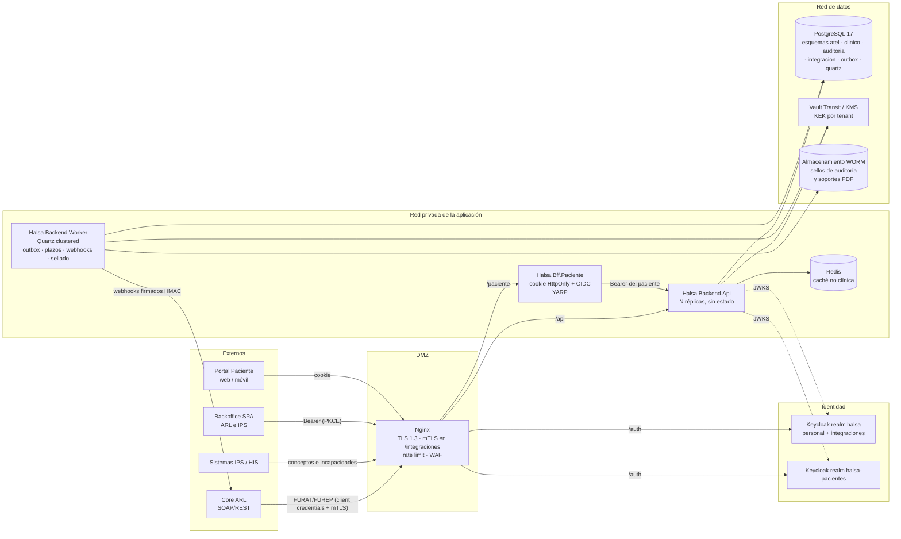

# ARQ 01 — Arquitectura backend, datos e integración para la gestión de siniestros ATEL

> **Estado:** Aprobado
> **Depende de:** Plantilla base `Halsa.Backend` (Clean Architecture, CQRS, outbox, Keycloak)
> **Fecha:** 2026-10-09
> **Objetivo:** Definir cómo el backend Halsa recibe, custodia y expone los casos ATEL de varias ARL sin que ningún actor no autorizado pueda leer el detalle clínico.

Contrato de API asociado: [`docs/api/atel-api.openapi.yaml`](../api/atel-api.openapi.yaml).

---

## 0. Por qué existe este documento

La plataforma maneja datos sensibles de salud (Ley 1581/2012, art. 5) de trabajadores afiliados a varias ARL, que compiten entre sí.
Dos riesgos condicionan todas las decisiones:

1. **Fuga clínica dentro del propio sistema:** un analista administrativo de la ARL ve un diagnóstico que no le corresponde.
2. **Fuga entre tenants:** la ARL A ve un caso de la ARL B.

Por eso el diseño no confía en la disciplina de los desarrolladores.
La separación se aplica en capas independientes: modelo de dominio, `DbContext`, rol de PostgreSQL, Row-Level Security y cifrado de campos.
Cada capa debe fallar cerrada aunque las demás fallen.

### Corrección sobre los entes de control

| Actor | Supervisor | Implicación para el diseño |
| --- | --- | --- |
| ARL (aseguradora de riesgos laborales) | **Superintendencia Financiera** + Ministerio del Trabajo | La auditoría debe poder exportarse para la SFC y para MinTrabajo, no solo para Supersalud. |
| IPS (prestador) | **Supersalud** | La custodia de la historia clínica (HC) por parte de la IPS se audita aquí. |
| Tratamiento de datos personales | **SIC** (Delegatura de Protección de Datos) | Registro Nacional de Bases de Datos, autorización y finalidad. |

El log de auditoría se diseña con un formato neutro y exportable (ver §3.3), válido ante cualquiera de los tres.

---

## 1. Alcance

**Incluido:**

- Arquitectura lógica de despliegue: Nginx → Keycloak / BFF / API → Worker → PostgreSQL.
- Estrategia de multi-tenancy en Keycloak, en EF Core y en PostgreSQL.
- Aislamiento y cifrado del detalle clínico.
- Log de auditoría inmutable de lecturas y escrituras clínicas.
- Motor de plazos legales con jobs en background y webhooks salientes.
- Contrato de entrada FURAT/FUREP (webhook de la ARL) y carga de incapacidad (frontend e IPS).
- Autorización de accesos sensibles, con el dictamen PCL como ejemplo.

**Fuera de alcance (specs futuras):**

- Fachada HL7 FHIR R4 completa (aquí solo se deja la costura, §4.4).
- Integración con las Juntas de Calificación de Invalidez.
- Liquidación y pago de prestaciones económicas.
- Portal del empleador.
- Firma digital de documentos clínicos (certificado digital del profesional).
- Analítica y bodega de datos.

---

## 2. Arquitectura lógica



### Responsabilidades por componente

| Componente | Responsabilidad | Lo que **no** hace |
| --- | --- | --- |
| Nginx | Termina TLS y exige mTLS en `/api/v1/integraciones/*`. Aplica rate limit por cliente y `client_max_body_size 15m`. Reenvía `X-Forwarded-*`. | No valida JWT. La API siempre lo revalida. |
| Keycloak | Emite tokens. Gestiona MFA, step-up (`acr`) y service accounts de integración. | No decide acceso a un caso concreto (eso es ABAC en la API). |
| BFF Paciente | Ejecuta el flujo OIDC confidencial. Guarda los tokens en el servidor y entrega al navegador solo una cookie `__Host-` con `SameSite=Strict`. | No tiene lógica de negocio. Solo reenvía a `/api/v1/paciente/*`. |
| API | Expone casos, carga clínica, incapacidades e ingesta de integraciones. Aplica la autorización y escribe la auditoría. | No ejecuta jobs largos. |
| Worker | Drena el outbox. Calcula plazos. Despacha webhooks. Sella la auditoría. | No expone HTTP público, solo `/health`. |
| PostgreSQL | Fuente de verdad. Aplica RLS y permisos por rol. | No conoce las llaves de cifrado. |

Hoy la plantilla ejecuta `OutboxProcessor` dentro de la API.
La API y el Worker salen **de la misma imagen**: la variable `Halsa__Role=Api|Worker` decide qué hosted services se registran.
Así escalar la API no multiplica los jobs.
El Worker también puede tener reglas de egreso propias, porque es el único componente que llama hacia afuera.

### Nginx: fragmento relevante

```nginx
# Integraciones: mTLS con la CA que emite certificados a cada ARL/IPS.
location /api/v1/integraciones/ {
    if ($ssl_client_verify != SUCCESS) { return 403; }
    proxy_set_header X-Client-Cert-Thumbprint $ssl_client_fingerprint;
    limit_req zone=integraciones burst=50 nodelay;
    client_max_body_size 2m;
    proxy_pass http://halsa_api;
}

location /api/ {
    limit_req zone=usuarios burst=20;
    client_max_body_size 15m;            # soportes PDF de incapacidad
    proxy_pass http://halsa_api;
}

location /auth/admin/ { return 404; }    # la consola de Keycloak solo se publica en la red de administración
```

La API compara `X-Client-Cert-Thumbprint` con el claim `cnf.x5t#S256` del token.
Esto amarra el token al certificado (RFC 8705), así que un token robado no sirve sin la llave privada.

---

## 3. Marco legal convertido en mecanismos técnicos

| Norma | Exigencia | Mecanismo |
| --- | --- | --- |
| Res. 1995/1999 | La HC es un documento privado y sometido a reserva. Solo acceden el paciente, el equipo de salud, las autoridades judiciales y los demás casos de ley. No admite enmendaduras. | Esquema `clinico` aislado. Tablas *append-only*: una corrección es un registro nuevo con `corrige_a`. ABAC por asignación al caso. |
| Res. 839/2017 | Retención mínima de la HC: 15 años desde la última atención. | `retener_hasta` por registro. Se prohíbe el borrado físico antes de esa fecha, incluso en la baja de un tenant. |
| Ley 23/1981, art. 37 | Secreto profesional médico. | El rol `analista-arl` no recibe ningún permiso `clinico:*`. |
| Ley 1581/2012 y Decreto 1377/2013 | El dato de salud es sensible. Requiere autorización explícita, finalidad y medidas de seguridad. | Cifrado de campo con llave por tenant. Minimización en las respuestas. Registro de consentimiento por trabajador. |
| Ley 2015/2020 y Res. 866/2021 | Interoperabilidad de la HC electrónica. | Modelo canónico mapeable a FHIR (§4.4). |
| Res. 156/2005 | Formatos FURAT y FUREP. | Contrato `FuratRequest` / `FurepRequest`. |
| Decreto 1072/2015 (SG-SST) y Res. 1401/2007 | Investigación de incidentes y accidentes. | Plazos en el motor de términos (§3.4). |
| Decreto-ley 019/2012, art. 142, y Decreto 1352/2013 | Calificación en primera oportunidad y controversia ante la Junta. | Plazos de notificación y controversia. |
| Ley 776/2002 y Decreto 1507/2014 | Incapacidad temporal (180 + 180 días) y manual de calificación PCL. | Validaciones de la incapacidad. Alertas por acumulado de días. |

> ⚠️ **Los plazos son datos, no código.** Antes de salir a producción, el área jurídica debe validar cada valor de la tabla `sst.reglas_termino` (§3.4). Las cifras de este documento son el punto de partida, no la fuente de verdad.

### 3.1 Aislamiento del detalle clínico

La regla de diseño es que una consulta administrativa **no puede** alcanzar el detalle clínico.
No basta con que "no deba".
Hay cinco barreras independientes:

1. **Dominio separado.** `CasoMedico` (namespace `Domain.Casos`) no tiene navegación hacia `HistoriaClinicaDetalle` (namespace `Domain.Clinico`). Solo `HistoriaClinicaDetalle` guarda el `CasoMedicoId`. Un test de NetArchTest impide que `Application.Casos` dependa de `Domain.Clinico`.
2. **`DbContext` separado.** `ApplicationDbContext` no mapea ninguna tabla de `clinico`, y `ClinicalDbContext` es el único que lo hace. `ApplyConfigurationsFromAssembly` se filtra por namespace para que un contexto no recoja las configuraciones del otro.
3. **Rol de base de datos separado.** `ApplicationDbContext` se conecta como `halsa_app`, que no tiene `USAGE` sobre el esquema `clinico`. Ni siquiera un `FromSqlRaw` puede leerlo. `ClinicalDbContext` se conecta como `halsa_clinico`, y las migraciones corren como `halsa_owner`. Ninguno de los roles de ejecución es dueño de las tablas ni tiene `BYPASSRLS`.
4. **Row-Level Security por tenant**, con `FORCE ROW LEVEL SECURITY` (§3.2).
5. **Cifrado de campo en la aplicación.** Se usa AES-256-GCM con una DEK por tenant, envuelta por una KEK en Vault o KMS. Un volcado de la base de datos, un backup o un DBA ven solo `bytea`. La AAD incluye `tenant_id` y el id del registro, así que no se puede copiar un ciphertext a otra fila.

Además, el disco va cifrado (LUKS o el cifrado del volumen del proveedor), y PostgreSQL exige TLS (`hostssl` en `pg_hba.conf`).
`pgaudit` registra el DDL y los accesos de los roles humanos.

### 3.2 Multi-tenancy en datos

**Decisión: una base de datos compartida, un esquema por bounded context y discriminador `tenant_id`, con RLS en PostgreSQL como defensa en profundidad.**

| Opción | Veredicto | Motivo |
| --- | --- | --- |
| Discriminador + global query filter + RLS | ✅ **Elegida** | Una sola migración y un solo pool de conexiones. Las IPS que atienden a varias ARL caben de forma natural. RLS cubre los olvidos del filtro de EF. |
| Esquema por ARL | ❌ | Las migraciones se multiplican por N. El modelo de EF Core se cachea por tipo de contexto, lo que obliga a un `IModelCacheKeyFactory` frágil. No resuelve el acceso cruzado de las IPS. |
| Base de datos por ARL | ⏸ Vía de escape | Se reserva para una ARL que lo exija por contrato. El `ITenantConnectionResolver` permite enrutar un tenant a otra cadena de conexión sin cambiar código de dominio. |

El tenant es **la ARL**.
Una IPS no es un tenant, sino un actor transversal.
Una IPS ve un caso solo si existe una remisión vigente hacia ella (`atel.remisiones`).

```sql
ALTER TABLE clinico.historia_clinica_detalle ENABLE ROW LEVEL SECURITY;
ALTER TABLE clinico.historia_clinica_detalle FORCE ROW LEVEL SECURITY;

CREATE POLICY p_tenant ON clinico.historia_clinica_detalle
USING (
    -- Personal de la ARL: solo su tenant.
    (current_setting('app.actor_tipo', true) = 'arl'
        AND tenant_id = current_setting('app.tenant_id', true))
    OR
    -- Personal de la IPS: solo los casos remitidos a su IPS y vigentes.
    (current_setting('app.actor_tipo', true) = 'ips'
        AND EXISTS (SELECT 1 FROM atel.remisiones r
                    WHERE r.caso_medico_id = historia_clinica_detalle.caso_medico_id
                      AND r.ips_id = current_setting('app.ips_id', true)
                      AND r.vigente))
);
-- Si las variables no están definidas, current_setting(..., true) devuelve NULL y la consulta no devuelve filas.

REVOKE UPDATE, DELETE, TRUNCATE ON clinico.historia_clinica_detalle FROM halsa_clinico;
```

Un `DbConnectionInterceptor` define las variables de sesión en `ConnectionOpened` (`set_config('app.tenant_id', @t, false)`).
También las limpia en `ConnectionClosing`, para que una conexión devuelta al pool no conserve el tenant anterior.
El valor sale de `ITenantContext`, que se llena **solo** a partir de los claims del token, nunca de un header ni de la URL.

### 3.3 Auditoría legal inmutable

Tabla `auditoria.accesos`. Es *append-only* y tiene particiones mensuales.

| Columna | Contenido |
| --- | --- |
| `id` | UUID v7 |
| `ocurrido_en` | `timestamptz` del servidor (`IClock`) |
| `tenant_id`, `actor_id` (`sub`), `actor_tipo`, `actor_roles` | Quién accedió |
| `client_id`, `ip`, `user_agent`, `correlation_id` | Desde dónde accedió |
| `accion` | `LEER`, `CREAR`, `CORREGIR`, `EXPORTAR`, `DENEGADO` |
| `recurso_tipo`, `recurso_id`, `caso_medico_id` | Sobre qué recurso |
| `motivo` | Justificación (obligatoria en *break-the-glass*) |
| `acr`, `resultado` | Nivel de autenticación y resultado |
| `hash_registro` | SHA-256 del registro en forma canónica (JCS, RFC 8785) |

Reglas:

- **Las escrituras se auditan en la misma transacción** que el cambio. Si la auditoría falla, el cambio se revierte.
- **Las lecturas fallan cerradas.** El `ClinicalAuditBehavior` (un pipeline behavior de la mediación) inserta el registro de auditoría **antes** de devolver los datos. Si la inserción falla, la consulta devuelve un error y no entrega datos. Toda consulta que implemente `IClinicalQuery` pasa por ese behavior.
- **Los intentos denegados también se auditan** (`DENEGADO`), porque son la señal de fisgoneo más valiosa.
- **Inmutabilidad.** El rol `halsa_app` solo tiene `INSERT` y `SELECT`. Un trigger `BEFORE UPDATE OR DELETE` lanza una excepción incluso al dueño.
- **Sellado por lotes.** Cada 5 minutos, el Worker calcula una raíz Merkle de los registros nuevos de cada tenant. La guarda en `auditoria.sellos` firmada con una llave de Vault y la exporta a almacenamiento WORM (Object Lock en modo *compliance*). Alterar un registro rompe la raíz publicada. Una cadena de hashes registro por registro se descarta porque serializa todas las escrituras de un tenant.
- La retención es igual a la de la HC (15 años). La exportación para los entes de control es JSON Lines firmado con el sello correspondiente.

### 3.4 Motor de términos de ley (SLA)

No se programa un job por cada plazo.
Hay **plazos como filas** y **un job barredor**:

```text
sst.reglas_termino   (codigo, evento_disparador, cantidad, unidad[HABILES|CALENDARIO|HORAS],
                      alerta_previa, base_legal, vigente_desde, vigente_hasta)
sst.plazos           (id, tenant_id, caso_medico_id, regla_codigo, inicia_en, vence_en,
                      alerta_en, estado[ABIERTO|CUMPLIDO|VENCIDO|SUSPENDIDO], cumplido_en)
sst.festivos         (fecha, descripcion)   -- calendario de Colombia (Ley 51/1983), cargado cada año
```

1. Un evento de dominio (`CasoRadicado`, `DictamenOrigenNotificado`…) crea las filas de `sst.plazos` en la misma transacción. Un `CalculadoraDiasHabiles` calcula `vence_en` usando `sst.festivos`.
2. `BarridoPlazosJob` (Quartz, cada minuto, `[DisallowConcurrentExecution]`, en un clúster sobre el `JobStore` de PostgreSQL) toma lotes con `FOR UPDATE SKIP LOCKED`, como ya hace `OutboxProcessor`:
   - Si `alerta_en <= now()`, emite `PlazoProximoAVencer`.
   - Si `vence_en <= now()` y el plazo sigue en `ABIERTO`, lo pasa a `VENCIDO` y emite `PlazoVencido`.
3. Los eventos van al outbox, y `WebhookDispatcher` los entrega a las suscripciones de cada ARL (`integracion.suscripciones_webhook`):
   - Firma HMAC-SHA256 en el header `Halsa-Signature: t=<unix>,v1=<hex>`.
   - Reintentos con backoff exponencial y jitter durante 24 h; después, a `dead_letter`.
   - Entrega *at-least-once*. El receptor deduplica por `evento_id`.
4. Los plazos se recalculan cuando cambia la regla o el calendario. Un plazo nunca se acorta retroactivamente.

Reglas iniciales (**pendientes de validación jurídica**):

| Código | Disparador | Plazo | Base |
| --- | --- | --- | --- |
| `REPORTE_FURAT` | Ocurrencia del AT | 2 días hábiles | Decreto 1295/1994, art. 62; Res. 156/2005 |
| `REPORTE_FUREP` | Diagnóstico de la EL | 2 días hábiles | Ídem |
| `INVESTIGACION_AT` | Ocurrencia del AT | 15 días calendario | Res. 1401/2007; Decreto 1072/2015, art. 2.2.4.6.32 |
| `REMISION_INVESTIGACION_GRAVE` | AT grave o mortal | 15 días calendario | Res. 1401/2007 |
| `CONTROVERSIA_DICTAMEN` | Notificación del dictamen | 10 días hábiles | Decreto-ley 019/2012, art. 142 |
| `TOPE_IT_180` | Inicio de la incapacidad temporal | 180 días acumulados (alerta en el día 150) | Ley 776/2002, art. 3 |

---

## 4. Integración multi-actor

### 4.1 Keycloak: realms y clients

**Decisión: dos realms, no uno por ARL.**

| Realm | Usuarios | Política |
| --- | --- | --- |
| `halsa` | Personal de las ARL e IPS, auditores y service accounts de integración | MFA obligatoria (OTP/WebAuthn). Sin autorregistro. Keycloak Organizations: una organización por ARL y por IPS. |
| `halsa-pacientes` | Trabajadores | Autorregistro con verificación de identidad. Políticas de contraseña y sesión distintas. |

Un realm por ARL se descarta por tres razones:

- Habría N emisores que la API tendría que conocer.
- La configuración se desalinearía entre realms.
- Un médico de una IPS que atiende a cinco ARL necesitaría cinco cuentas.

Separar a los pacientes en su propio realm sí compensa: sus políticas de autenticación son distintas, y un token de paciente nunca puede validar contra un endpoint del personal porque el emisor es otro.

**Clients del realm `halsa`:**

| Client | Tipo | Flujo | Notas |
| --- | --- | --- | --- |
| `halsa-api` | Bearer-only (audiencia) | — | Sus *client roles* son los permisos (`casos:read`, `pcl:dictamen:read`…). Es lo que ya lee `KeycloakClaimsTransformation`. |
| `halsa-backoffice` | Público (SPA) | Authorization Code + PKCE | Mapper de audiencia hacia `halsa-api`. Access token de 5 min. |
| `int-arl-{codigo}` | Confidencial, service account | Client Credentials con `private_key_jwt` y tokens ligados a certificado (mTLS) | Mapper *hardcoded claim* `tenant_id={codigo}`. Rol `integracion:furat:write`. |
| `int-ips-{reps}` | Confidencial, service account | Ídem | Mapper `ips_id={codigo REPS}`. Roles `integracion:clinico:write` e `incapacidades:write`. |

**Client del realm `halsa-pacientes`:** `halsa-bff-paciente`, confidencial, con Authorization Code + PKCE. Los tokens nunca llegan al navegador.

**Claims que la API consume:**

| Claim | Origen | Uso |
| --- | --- | --- |
| `sub` | Estándar | Actor de la auditoría y vínculo paciente ↔ trabajador |
| `tenant_id` | Atributo de la organización o mapper | RLS y filtro de EF |
| `ips_id` | Atributo de la organización IPS | RLS de remisiones |
| `actor_tipo` | Mapper (`arl`, `ips`, `paciente`, `integracion`) | RLS y ABAC |
| `acr`, `auth_time` | Step-up de Keycloak (*ACR to LoA mapping*: `1` = contraseña, `2` = MFA) | Accesos sensibles |
| `resource_access.halsa-api.roles` | Client roles | Permisos |
| `cnf.x5t#S256` | Token ligado a certificado | Integraciones |

### 4.2 Ingesta de FURAT y FUREP (webhook entrante)

`POST /api/v1/integraciones/furat`. El payload completo está en el contrato OpenAPI.

1. Nginx valida mTLS, y la API valida el JWT, el `tenant_id` y el thumbprint.
2. **`Idempotency-Key` es obligatorio.** Se guarda en `integracion.solicitudes_idempotentes`, con TTL de 72 h y el hash del cuerpo:
   - Misma llave y mismo cuerpo: devuelve la respuesta original.
   - Misma llave y otro cuerpo: `409`.
3. Validación sintáctica con FluentValidation: tipos de documento, códigos DIVIPOLA, CIIU, fechas no futuras, etc.
4. Se persiste el **mensaje crudo** en `integracion.mensajes_entrantes` (cifrado, porque contiene la descripción del evento) y se crea el `CasoMedico` en estado `Radicado`, en la misma transacción. La respuesta es `202 Accepted` con el `radicado`.
5. El enriquecimiento posterior (cruce con la afiliación en el core de la ARL y deduplicación por trabajador + fecha) es asíncrono. Su resultado se notifica con el webhook `caso.validado` o `caso.rechazado`.

El FURAT trae datos clínicos mínimos: tipo de lesión, parte del cuerpo y la descripción del evento.
Esos campos **se separan en la ingesta**:

- Lo administrativo va a `atel.casos_medicos`.
- La lesión y la descripción van a `clinico.historia_clinica_detalle` como un registro de tipo `REPORTE_INICIAL`.

### 4.3 BFF del Portal Paciente

- Es un host separado, `Halsa.Bff.Paciente`, con YARP y autenticación por cookie + OIDC. Se usa un BFF en lugar de tokens en el navegador por la exposición a XSS en un portal masivo.
- Los endpoints de la API para pacientes **no reciben ids de trabajador**. Siempre se resuelven desde `sub` (`/api/v1/paciente/mis-casos`). Así se elimina el IDOR por diseño.
- Hay endpoints de agregación pensados para pantallas móviles:
  - `GET /api/v1/paciente/resumen`: casos activos, incapacidades vigentes, próximos hitos y estado de los pagos, en una sola llamada.
  - `GET /api/v1/paciente/casos/{id}/linea-tiempo`: hitos administrativos.
  - `POST /api/v1/paciente/casos/{id}/solicitudes-copia-hc`: el paciente pide copia de su HC (art. 14 de la Res. 1995/1999). Queda auditada, y la entrega la hace un profesional, no el portal.
- El paciente ve los **hitos y estados**, no el detalle clínico en línea. La copia de la HC sigue el flujo formal.

### 4.4 Interoperabilidad: costura para HL7 FHIR

- **Capa anticorrupción.** Todo lo que entra se traduce a un modelo canónico interno (`Application.Integraciones.Canonico`). Los adaptadores son `FuratV1Adapter` y `FurepV1Adapter`, y más adelante vendrá `FhirBundleAdapter`.
- **Mapeo previsto** a FHIR R4 con los perfiles colombianos que publique MinSalud para la IHCE:

  | Halsa | FHIR R4 |
  | --- | --- |
  | `CasoMedico` | `EpisodeOfCare` |
  | Evento AT | `Encounter` + `Condition` |
  | Concepto médico | `Composition` / `DocumentReference` |
  | Incapacidad | `Claim` o un perfil local (pendiente del perfil oficial) |
  | Trabajador | `Patient` |
  | IPS | `Organization` |

- Los códigos se guardan con su sistema (`{ "sistema": "CIE-10", "codigo": "S62.6" }`) para que el mapeo a `CodeableConcept` sea directo.

---

## 5. Modelo de datos (EF Core)

Se siguen las convenciones de la plantilla: ids fuertemente tipados con UUID v7, `AggregateRoot<TId>`, `Result` para los errores esperados y snake_case por `EFCore.NamingConventions`.

### 5.1 Dominio administrativo: `CasoMedico`

```csharp
namespace Halsa.Backend.Domain.Casos;

public readonly record struct CasoMedicoId(Guid Value)
{
    public static CasoMedicoId New() => new(Guid.CreateVersion7());
}

/// <summary>Código de la ARL. Es el tenant.</summary>
public readonly record struct TenantId(string Value);

public enum TipoEvento { AccidenteTrabajo = 1, EnfermedadLaboral = 2 }

public enum EstadoCaso { Radicado, Validado, EnAtencion, EnCalificacionOrigen, EnCalificacionPcl, Cerrado, Rechazado }

/// <summary>Documento de identidad. Es dato personal, pero no clínico.</summary>
public sealed record Identificacion(string Tipo, string Numero);

/// <summary>
/// Sólo el resultado que necesita la gestión administrativa para pagar prestaciones.
/// La motivación clínica del dictamen vive en <c>Domain.Clinico.DictamenPcl</c>.
/// </summary>
public sealed record ResultadoCalificacion(decimal? PorcentajePcl, DateOnly? FechaEstructuracion, string Origen);

/// <summary>
/// Expediente administrativo del siniestro. Deliberadamente NO tiene navegación hacia el detalle
/// clínico: lo que no está en el grafo no puede filtrarse por un Include ni por la serialización.
/// </summary>
public sealed class CasoMedico : AggregateRoot<CasoMedicoId>, ITenantScoped
{
    private CasoMedico() { }

    public TenantId TenantId { get; private set; }
    public string Radicado { get; private set; } = string.Empty;
    public TipoEvento TipoEvento { get; private set; }
    public DateTimeOffset FechaEvento { get; private set; }
    public Identificacion Trabajador { get; private set; } = null!;
    public Identificacion Empleador { get; private set; } = null!;
    public string MunicipioDivipola { get; private set; } = string.Empty;
    public EstadoCaso Estado { get; private set; }
    public bool EsGraveOMortal { get; private set; }
    public ResultadoCalificacion? Calificacion { get; private set; }
    public DateTimeOffset RadicadoEn { get; private set; }
    public uint Version { get; private set; }   // xmin de PostgreSQL como token de concurrencia

    public static Result<CasoMedico> RadicarDesdeFurat(
        TenantId tenantId, string radicado, Identificacion trabajador, Identificacion empleador,
        DateTimeOffset fechaEvento, string municipio, bool graveOMortal, DateTimeOffset ahora)
    {
        if (fechaEvento > ahora)
        {
            return Result.Failure<CasoMedico>(CasoMedicoErrors.FechaEventoFutura);
        }

        var caso = new CasoMedico
        {
            Id = CasoMedicoId.New(), TenantId = tenantId, Radicado = radicado,
            TipoEvento = TipoEvento.AccidenteTrabajo, FechaEvento = fechaEvento,
            Trabajador = trabajador, Empleador = empleador, MunicipioDivipola = municipio,
            EsGraveOMortal = graveOMortal, Estado = EstadoCaso.Radicado, RadicadoEn = ahora
        };

        caso.Raise(new CasoRadicadoDomainEvent(caso.Id, tenantId, TipoEvento.AccidenteTrabajo, fechaEvento, graveOMortal));

        return caso;
    }
}
```

### 5.2 Dominio clínico: `HistoriaClinicaDetalle`

```csharp
namespace Halsa.Backend.Domain.Clinico;

public readonly record struct HistoriaClinicaDetalleId(Guid Value)
{
    public static HistoriaClinicaDetalleId New() => new(Guid.CreateVersion7());
}

public enum TipoRegistroClinico { ReporteInicial, ConceptoMedico, Evolucion, ConceptoRehabilitacion, DictamenPcl }

/// <summary>
/// Valor cifrado con AES-256-GCM. La llave (DEK) es la del tenant, identificada por <see cref="KeyId"/>
/// para poder rotarla. La AAD es "{tenantId}|{registroId}|{campo}", así que no se puede reubicar.
/// </summary>
public sealed record CampoCifrado(byte[] Ciphertext, byte[] Nonce, byte[] Tag, string KeyId);

/// <summary>Profesional que firma el registro. El registro RETHUS da trazabilidad ante el ente de control.</summary>
public sealed record ProfesionalRef(string Sub, Identificacion Identificacion, string RegistroRethus);

/// <summary>
/// Registro de historia clínica asociado a un caso. Es append-only (Res. 1995/1999, sin enmendaduras):
/// no hay setters públicos y una corrección es un registro nuevo que apunta al anterior con CorrigeA.
/// </summary>
public sealed class HistoriaClinicaDetalle : AggregateRoot<HistoriaClinicaDetalleId>, ITenantScoped
{
    private HistoriaClinicaDetalle() { }

    public TenantId TenantId { get; private set; }

    /// <summary>Sólo el identificador. Nunca una navegación hacia el agregado administrativo.</summary>
    public CasoMedicoId CasoMedicoId { get; private set; }

    public TipoRegistroClinico Tipo { get; private set; }
    public ProfesionalRef Profesional { get; private set; } = null!;
    public DateTimeOffset RegistradoEn { get; private set; }
    public DateOnly RetenerHasta { get; private set; }            // Res. 839/2017
    public HistoriaClinicaDetalleId? CorrigeA { get; private set; }

    /// <summary>Documento clínico (anamnesis, examen, análisis, plan) serializado y cifrado.</summary>
    public CampoCifrado Contenido { get; private set; } = null!;

    /// <summary>CIE-10 principal, cifrado.</summary>
    public CampoCifrado? DiagnosticoPrincipal { get; private set; }

    /// <summary>
    /// HMAC-SHA256(llaveIndice_tenant, codigoCie10). Permite buscar por diagnóstico exacto
    /// sin descifrar y sin guardar el código en claro.
    /// </summary>
    public byte[]? DiagnosticoIndiceCiego { get; private set; }

    public static HistoriaClinicaDetalle Registrar(
        TenantId tenantId, CasoMedicoId casoId, TipoRegistroClinico tipo, ProfesionalRef profesional,
        CampoCifrado contenido, CampoCifrado? diagnostico, byte[]? indiceCiego, DateTimeOffset ahora) =>
        new()
        {
            Id = HistoriaClinicaDetalleId.New(), TenantId = tenantId, CasoMedicoId = casoId, Tipo = tipo,
            Profesional = profesional, RegistradoEn = ahora,
            RetenerHasta = DateOnly.FromDateTime(ahora.UtcDateTime).AddYears(15),
            Contenido = contenido, DiagnosticoPrincipal = diagnostico, DiagnosticoIndiceCiego = indiceCiego
        };
}
```

El cifrado se hace **explícitamente en el handler**, a través de `IClinicalCipher` (`Application.Abstractions.Clinico`).
No se usa un `ValueConverter` de EF Core, por dos motivos:

- Un converter no conoce el tenant ni el id de la fila, que hacen falta para elegir la DEK y construir la AAD.
- El modelo de EF se cachea por tipo de contexto, así que un converter con estado por request es un error latente.

### 5.3 Dos contextos, dos roles

```csharp
namespace Halsa.Backend.Infrastructure.Database;

// Contexto administrativo existente (rol halsa_app). Solo se añade el filtro de namespace.
public sealed class ApplicationDbContext(DbContextOptions<ApplicationDbContext> options, ITenantContext tenant)
    : DbContext(options), IReadDbContext, IUnitOfWork
{
    // EF parametriza las propiedades del contexto en los query filters, así que el filtro se evalúa por request.
    private TenantId CurrentTenant => tenant.TenantId;
    private bool ActorEsIps => tenant.Tipo == ActorTipo.Ips;

    internal DbSet<CasoMedico> Casos => Set<CasoMedico>();

    protected override void OnModelCreating(ModelBuilder modelBuilder)
    {
        modelBuilder.HasDefaultSchema(Schemas.Default);

        // Sin este filtro, ApplyConfigurationsFromAssembly también registraría las tablas clínicas.
        modelBuilder.ApplyConfigurationsFromAssembly(
            typeof(ApplicationDbContext).Assembly,
            type => type.Namespace != typeof(ClinicalDbContext).Namespace + ".Clinico");

        // Un actor IPS no tiene tenant: lo restringen la RLS de remisiones y el ABAC del §6.
        modelBuilder.Entity<CasoMedico>().HasQueryFilter(c => ActorEsIps || c.TenantId == CurrentTenant);
    }
}

// Contexto clínico (rol halsa_clinico, otra cadena de conexión). Solo lo inyectan los handlers del módulo Clinico.
public sealed class ClinicalDbContext(DbContextOptions<ClinicalDbContext> options, ITenantContext tenant)
    : DbContext(options), IClinicalDbContext
{
    private TenantId CurrentTenant => tenant.TenantId;
    private bool ActorEsIps => tenant.Tipo == ActorTipo.Ips;

    internal DbSet<HistoriaClinicaDetalle> Registros => Set<HistoriaClinicaDetalle>();

    protected override void OnModelCreating(ModelBuilder modelBuilder)
    {
        modelBuilder.HasDefaultSchema(Schemas.Clinico);
        modelBuilder.ApplyConfigurationsFromAssembly(
            typeof(ClinicalDbContext).Assembly,
            type => type.Namespace == typeof(ClinicalDbContext).Namespace + ".Clinico");

        // Un actor IPS no tiene tenant: lo restringen la RLS de remisiones y el ABAC del §6.
        modelBuilder.Entity<HistoriaClinicaDetalle>().HasQueryFilter(r => ActorEsIps || r.TenantId == CurrentTenant);
    }
}
```

```csharp
namespace Halsa.Backend.Infrastructure.Database.Clinico;

internal sealed class HistoriaClinicaDetalleConfiguration : IEntityTypeConfiguration<HistoriaClinicaDetalle>
{
    public void Configure(EntityTypeBuilder<HistoriaClinicaDetalle> builder)
    {
        builder.ToTable("historia_clinica_detalle", Schemas.Clinico);
        builder.HasKey(r => r.Id);
        builder.Property(r => r.Id).HasConversion(id => id.Value, v => new HistoriaClinicaDetalleId(v));
        builder.Property(r => r.CasoMedicoId).HasConversion(id => id.Value, v => new CasoMedicoId(v));
        builder.Property(r => r.TenantId).HasConversion(t => t.Value, v => new TenantId(v)).HasMaxLength(20);
        builder.Property(r => r.Tipo).HasConversion<string>().HasMaxLength(40);

        builder.ComplexProperty(r => r.Contenido, c =>
        {
            c.Property(x => x.Ciphertext).HasColumnName("contenido_ct");
            c.Property(x => x.Nonce).HasColumnName("contenido_nonce");
            c.Property(x => x.Tag).HasColumnName("contenido_tag");
            c.Property(x => x.KeyId).HasColumnName("contenido_key_id").HasMaxLength(64);
        });
        // DiagnosticoPrincipal sigue el mismo patrón, con columnas diagnostico_*.

        builder.ComplexProperty(r => r.Profesional);
        builder.HasIndex(r => new { r.TenantId, r.CasoMedicoId, r.RegistradoEn });
        builder.HasIndex(r => new { r.TenantId, r.DiagnosticoIndiceCiego });

        // Sin FK hacia atel.casos_medicos: halsa_clinico no tiene permisos sobre atel.
        // La integridad la garantiza el handler, que verifica el caso por IClinicalCaseGate.
    }
}
```

### 5.4 Lo que ve una consulta administrativa

```csharp
// Application.Casos.Queries. La proyección es explícita: nunca se devuelve la entidad.
public sealed record CasoResumenResponse(
    Guid Id, string Radicado, string TipoEvento, string Estado, DateTimeOffset FechaEvento,
    string TrabajadorDocumento, bool TieneCalificacion, decimal? PorcentajePcl);
```

Con `CasoResumenResponse`, el analista de la ARL recibe el porcentaje de PCL que necesita para liquidar.
No recibe la motivación clínica, los diagnósticos ni los conceptos.

**Test de arquitectura nuevo** (`tests/Halsa.Backend.ArchitectureTests`):

- Los tipos de `Halsa.Backend.Application.Casos` no deben depender de `Halsa.Backend.Domain.Clinico` ni de `IClinicalDbContext`.
- Solo los tipos de `Halsa.Backend.Application.Clinico` pueden depender de `IClinicalDbContext`.

### 5.5 Por qué el detalle clínico no es *event sourced*

La plantilla sugiere *event sourcing* para las HC, pero el almacén `event_store.events` es compartido.
Meter eventos clínicos ahí rompería la barrera 3 (el rol `halsa_app` lee `event_store`).
Una tabla *append-only* en `clinico`, con su propio rol, ya da la historia completa sin mezclar los permisos.
`CasoMedico` sí puede ser *event sourced* más adelante: su historia (cambios de estado, plazos) es un activo administrativo.

---

## 6. Autorización para accesos sensibles (dictamen PCL)

### 6.1 Defecto existente que hay que corregir primero

`AuthenticationInstaller` fija `MapInboundClaims = false`, pero `CurrentUser` lee `ClaimTypes.NameIdentifier` y `ClaimTypes.Email`.
Como los claims no se mapean, esos tipos nunca aparecen.
**Resultado: `UserId` es siempre `Guid.Empty` y `Email` es `null`.**
La auditoría depende del actor, así que esto es bloqueante.
La corrección es leer `"sub"` y `"email"` directamente en `src/Halsa.Backend.Infrastructure/Authentication/CurrentUser.cs`.

### 6.2 Validación en capas

| Capa | Qué valida | Dónde |
| --- | --- | --- |
| 1. Autenticación | Firma (JWKS), `iss` del realm correcto, `aud=halsa-api`, `exp`/`nbf` con 30 s de tolerancia, algoritmo `RS256`/`PS256` (se rechaza `none` y HS*) | `JwtBearer`, un esquema por realm (`Personal`, `Paciente`) |
| 2. Claims | Aplana roles a permisos. Construye `ITenantContext` (`tenant_id`, `ips_id`, `actor_tipo`). Rechaza el token si falta `tenant_id` en un actor ARL. | `KeycloakClaimsTransformation` + `TenantContextMiddleware` |
| 3. Permiso (RBAC) | `pcl:dictamen:read` | `PermissionAuthorizationHandler` existente |
| 4. Recurso (ABAC) | Tenant del caso, remisión vigente de la IPS, asignación del profesional, `acr`, antigüedad de `auth_time` | `AccesoClinicoHandler` con el recurso |
| 5. Datos | RLS con las variables de sesión | PostgreSQL |

```csharp
namespace Halsa.Backend.Infrastructure.Authorization;

public sealed record AccesoClinicoRequirement(string Permiso, int AcrMinimo, TimeSpan MaxAntiguedadAuth)
    : IAuthorizationRequirement;

/// <summary>El motivo viaja hasta el endpoint para responder con step-up (RFC 9470) y no con un 403 a secas.</summary>
public sealed class StepUpRequerido(IAuthorizationHandler handler, int acr, TimeSpan maxAge)
    : AuthorizationFailureReason(handler, "Se requiere autenticación reforzada.")
{
    public int Acr { get; } = acr;
    public TimeSpan MaxAge { get; } = maxAge;
}

internal sealed class AccesoClinicoHandler(ICasoAccessReader casos, ITenantContext actor, IClock clock)
    : AuthorizationHandler<AccesoClinicoRequirement, CasoMedicoId>
{
    protected override async Task HandleRequirementAsync(
        AuthorizationHandlerContext context, AccesoClinicoRequirement requirement, CasoMedicoId casoId)
    {
        ClaimsPrincipal user = context.User;

        if (!user.HasClaim(CurrentUser.PermissionClaimType, requirement.Permiso))
        {
            return;   // Sin Succeed: queda denegado.
        }

        bool acrSuficiente = int.TryParse(user.FindFirstValue("acr"), out int acr) && acr >= requirement.AcrMinimo;
        bool authReciente = long.TryParse(user.FindFirstValue("auth_time"), out long authTime)
            && clock.UtcNow - DateTimeOffset.FromUnixTimeSeconds(authTime) <= requirement.MaxAntiguedadAuth;

        if (!acrSuficiente || !authReciente)
        {
            context.Fail(new StepUpRequerido(this, requirement.AcrMinimo, requirement.MaxAntiguedadAuth));
            return;
        }

        // Lee solo la cabecera administrativa del caso (tenant, remisiones, equipo asignado). Nada clínico.
        CasoAcceso? caso = await casos.ObtenerAsync(casoId);

        bool permitido = caso is not null && actor.Tipo switch
        {
            ActorTipo.Arl => caso.TenantId == actor.TenantId
                             && caso.EquipoAsignado.Contains(actor.Sub),
            ActorTipo.Ips => caso.RemisionesVigentes.Contains(actor.IpsId!.Value)
                             && caso.EquipoAsignado.Contains(actor.Sub),
            _ => false   // Pacientes e integraciones nunca leen el dictamen por este camino.
        };

        if (permitido)
        {
            context.Succeed(requirement);
        }
    }
}
```

Registro de la política (en `AuthenticationInstaller.AddAuthorizationInternal`):

```csharp
services.AddAuthorizationBuilder()
    .AddPolicy(Policies.DictamenPclLectura, p => p
        .AddAuthenticationSchemes(AuthSchemes.Personal)
        .RequireAuthenticatedUser()
        .AddRequirements(new AccesoClinicoRequirement(Permissions.PclDictamenRead, AcrMinimo: 2,
                                                      MaxAntiguedadAuth: TimeSpan.FromMinutes(15))));
services.AddScoped<IAuthorizationHandler, AccesoClinicoHandler>();
```

Endpoint. La autorización es por recurso, así que el endpoint la invoca con el id del caso:

```csharp
internal sealed class GetDictamenPcl : IEndpoint
{
    public void MapEndpoint(IEndpointRouteBuilder app) =>
        app.MapGet("casos/{casoId:guid}/dictamen-pcl", async (
                Guid casoId, ClaimsPrincipal user, IAuthorizationService authz, ISender sender, CancellationToken ct) =>
            {
                var id = new CasoMedicoId(casoId);
                AuthorizationResult auth = await authz.AuthorizeAsync(user, id, Policies.DictamenPclLectura);

                if (!auth.Succeeded)
                {
                    // El handler de auditoría registra DENEGADO en ambos casos.
                    return auth.Failure?.FailureReasons.OfType<StepUpRequerido>().FirstOrDefault() is { } stepUp
                        ? CustomResults.StepUp(stepUp)   // 401 + WWW-Authenticate: Bearer error="insufficient_user_authentication", acr_values="2", max_age=900
                        : Results.Forbid();
                }

                Result<DictamenPclResponse> result = await sender.Send(new GetDictamenPclQuery(id), ct); // IClinicalQuery → auditado
                return result.Match(Results.Ok, _ => CustomResults.Problem(result));
            })
            .WithTags(Tags.Clinico)
            .WithName("GetDictamenPcl")
            .Produces<DictamenPclResponse>()
            .ProducesProblem(StatusCodes.Status401Unauthorized)
            .ProducesProblem(StatusCodes.Status403Forbidden)
            .RequireAuthorization(); // Exige un usuario autenticado. La política de recurso se evalúa arriba.
}
```

Cuando la SPA recibe un `401` con `insufficient_user_authentication`, redirige a Keycloak con `acr_values=2&max_age=900`.
Keycloak pide el segundo factor y emite un token nuevo con `acr=2`.

**Break-the-glass** (urgencias): existe el permiso `clinico:emergencia`. Permite saltarse la asignación, pero exige el header `Halsa-Motivo-Acceso` (mínimo 20 caracteres).
Cada uso queda en la auditoría con `motivo`, notifica en tiempo real al oficial de privacidad del tenant y genera una revisión obligatoria a las 72 h.

### 6.3 Catálogo de permisos (client roles de `halsa-api`)

| Rol de Keycloak (composite) | Permisos |
| --- | --- |
| `analista-arl` | `casos:read`, `casos:write`, `incapacidades:read`, `plazos:read` |
| `medico-laboral` | lo anterior + `clinico:read`, `clinico:write`, `incapacidades:write` |
| `medico-calificador` | lo anterior + `pcl:dictamen:read`, `pcl:dictamen:write` |
| `medico-ips` | `clinico:read`, `clinico:write`, `incapacidades:write` (sujeto a remisión) |
| `oficial-privacidad` | `auditoria:read`, `auditoria:export` |
| `integracion-arl` | `integracion:furat:write`, `integracion:furep:write`, `webhooks:manage` |
| `integracion-ips` | `integracion:clinico:write`, `incapacidades:write` |

`analista-arl` no tiene ningún `clinico:*` ni `pcl:dictamen:*`.
Un test funcional lo verifica (ver los criterios de aceptación).

---

## 7. Plan de implementación

Cada paso deja la solución compilando y con los tests en verde.

1. Corregir `CurrentUser` (`sub` y `email`) con un test unitario sobre un principal sin mapear.
2. Añadir `ITenantContext` y `TenantContextMiddleware`. El token de desarrollo de Keycloak (`docker/keycloak/cleanarch-realm.json`) gana el mapper `tenant_id`.
3. Crear `Domain.Casos` (`CasoMedico`) con `ApplicationDbContext`, el query filter y la migración `atel`.
4. Crear los roles `halsa_app`, `halsa_clinico` y `halsa_owner`, y las políticas RLS, con un script SQL en la migración. Test de integración: con `app.tenant_id` = A no se ve una fila de B.
5. Crear `Domain.Clinico`, `ClinicalDbContext`, `IClinicalCipher` (con un proveedor de llaves local en desarrollo) y el test de arquitectura de aislamiento.
6. Añadir `auditoria.accesos`, `ClinicalAuditBehavior` y el trigger de inmutabilidad.
7. Implementar `POST /integraciones/furat` con idempotencia y split clínico/administrativo.
8. Implementar `POST /casos/{id}/incapacidades` (multipart).
9. Añadir `AccesoClinicoHandler`, el endpoint del dictamen PCL y la respuesta de step-up.
10. Crear el host Worker: Quartz con el `JobStore` de PostgreSQL, `BarridoPlazosJob` y `sst.festivos`.
11. Añadir `WebhookDispatcher` y las suscripciones con firma HMAC.
12. Añadir el job de sellado de auditoría y la exportación WORM.
13. Crear el BFF del Portal Paciente y los endpoints `/paciente/*`.
14. Añadir Nginx a `docker-compose.yml`, con mTLS de desarrollo usando una CA local.

---

## 8. Criterios de aceptación

- [ ] `ICurrentUser.UserId` devuelve el `sub` del token de Keycloak de desarrollo (no `Guid.Empty`).
- [ ] Con el rol `halsa_app`, `SELECT 1 FROM clinico.historia_clinica_detalle` falla con `permission denied for schema clinico`.
- [ ] Con `app.tenant_id='ARL_A'`, una consulta sin `WHERE` sobre `atel.casos_medicos` no devuelve filas de `ARL_B`.
- [ ] Una conexión sin `app.tenant_id` no devuelve filas de las tablas con RLS.
- [ ] `UPDATE` y `DELETE` sobre `auditoria.accesos` fallan incluso con el rol `halsa_owner`.
- [ ] La columna `contenido_ct` no contiene el texto clínico en claro (verificado con `position()` sobre un valor conocido).
- [ ] Un token con rol `analista-arl` recibe `403` en `GET /casos/{id}/dictamen-pcl`.
- [ ] Un token `medico-calificador` asignado al caso, con `acr=1`, recibe `401` con `error="insufficient_user_authentication"`.
- [ ] El mismo token con `acr=2` y `auth_time` de hace menos de 15 min recibe `200`, y queda una fila `LEER` en `auditoria.accesos`.
- [ ] Un `POST /integraciones/furat` repetido con la misma `Idempotency-Key` y el mismo cuerpo devuelve el mismo `radicado` y crea un solo caso.
- [ ] La misma `Idempotency-Key` con otro cuerpo devuelve `409`.
- [ ] Un plazo de 2 días hábiles que inicia el viernes anterior a un lunes festivo vence el miércoles.
- [ ] Al vencer un plazo, el endpoint suscrito recibe un webhook cuya firma `Halsa-Signature` se verifica con el secreto compartido.
- [ ] El test de arquitectura falla si un tipo de `Application.Casos` referencia `Domain.Clinico`.

---

## 9. Decisiones

- **Sí:** discriminador `tenant_id` + query filter + RLS. Es una sola migración y RLS cubre los errores humanos.
- **No:** esquema por ARL. Complica migraciones y caché de modelo, y no resuelve las IPS transversales.
- **Diferido:** base de datos por ARL como opción contractual, gracias al `ITenantConnectionResolver`.
- **Sí:** dos `DbContext` y dos roles de PostgreSQL. El aislamiento clínico queda garantizado por permisos, no por convención.
- **Sí:** cifrado de campo en la aplicación (AES-GCM, DEK por tenant, KEK en Vault/KMS).
- **No:** `pgcrypto`. La llave tendría que viajar a la base de datos y quedaría en logs y en `pg_stat_statements`.
- **No:** `ValueConverter` para cifrar. Le falta el contexto del tenant y de la fila.
- **Sí:** dos realms (personal y pacientes), con Organizations para las ARL e IPS.
- **No:** un realm por ARL. Habría N emisores, desalineación de configuración y cuentas duplicadas para las IPS.
- **Sí:** Quartz.NET clustered en PostgreSQL. Es gratuito y tiene cron y clúster nativos.
- **No:** Hangfire. Las funciones de lotes y throttling son de pago. El dashboard es útil, pero la observabilidad ya va por OpenTelemetry y Seq.
- **Sí:** plazos como filas + un job barredor. Escala a millones de plazos y sobrevive a reinicios.
- **No:** un job programado por cada plazo.
- **Sí:** auditoría sellada por lotes con Merkle + WORM.
- **No:** cadena de hashes registro por registro, porque serializa las escrituras.
- **Sí:** BFF para pacientes. **No:** tokens en el navegador del paciente.
- **Sí:** step-up con `acr` + `auth_time` (RFC 9470) para PCL. **No:** pedir MFA en cada request.
- **Sí:** la ingesta responde `202` y el enriquecimiento es asíncrono. El core de la ARL no debe esperar a nuestras validaciones cruzadas.
- **No:** el detalle clínico en el `event_store` compartido (§5.5).

---

## 10. Riesgos

| Riesgo | Mitigación |
| --- | --- |
| Plazos legales mal parametrizados | La tabla `sst.reglas_termino` se valida con jurídica y está versionada por `vigente_desde`. Hay un test por cada regla. |
| Pérdida de la KEK, con la HC ilegible y el incumplimiento de la retención de 15 años | La KEK es multi-región en el KMS, con backup sellado fuera de línea. Hay un procedimiento de recuperación ensayado cada semestre. |
| Una conexión del pool conserva el tenant anterior | Se limpia en `ConnectionClosing`. RLS falla cerrado si la variable está vacía. Un test de integración reutiliza la conexión. |
| Un desarrollador mapea una tabla clínica en `ApplicationDbContext` | El filtro de namespace, el test de arquitectura y el rol sin `USAGE` hacen que falle en runtime. |
| Volumen de auditoría de lecturas | Particiones mensuales, índices por `(tenant_id, caso_medico_id)` y archivado de particiones antiguas a almacenamiento frío sin perder el sello. |
| Un core de ARL no soporta mTLS ni `private_key_jwt` | Hay una ruta degradada: `client_secret` + allowlist de IP en Nginx + HMAC del cuerpo. Es temporal y queda documentada por cliente. |
| Búsqueda por diagnóstico con el índice ciego | Se permite solo la igualdad exacta. Las agregaciones epidemiológicas se hacen en un proceso aparte que descifra con trazabilidad. |

---

## Qué **no** está en este documento

- Fachada FHIR completa (solo la costura).
- Integración con las Juntas de Calificación.
- Liquidación y pago de prestaciones.
- Portal del empleador.
- Firma digital de documentos clínicos.
- Analítica y bodega de datos.

Cada uno, si se aborda, va en su propia spec.
