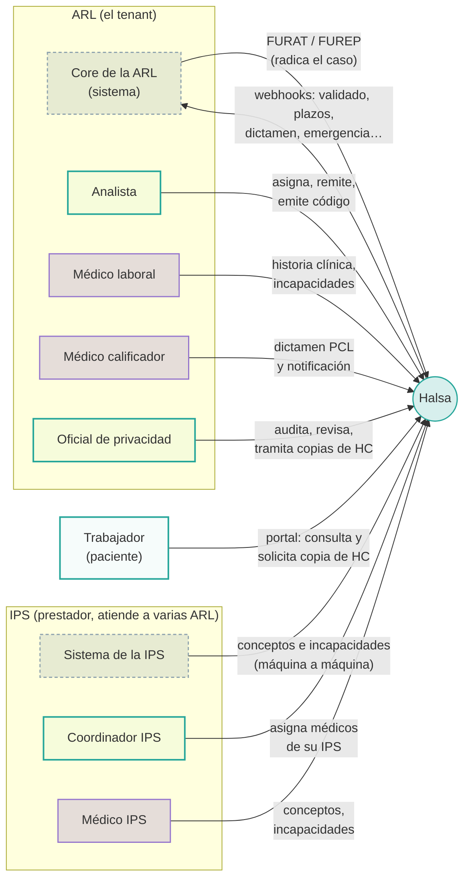
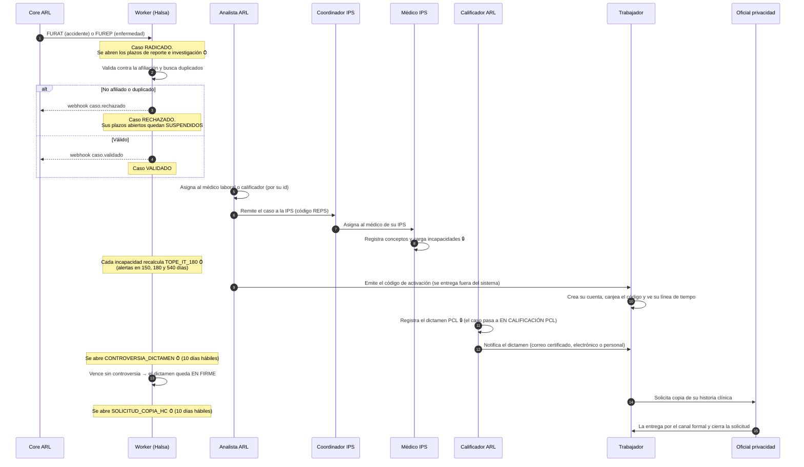
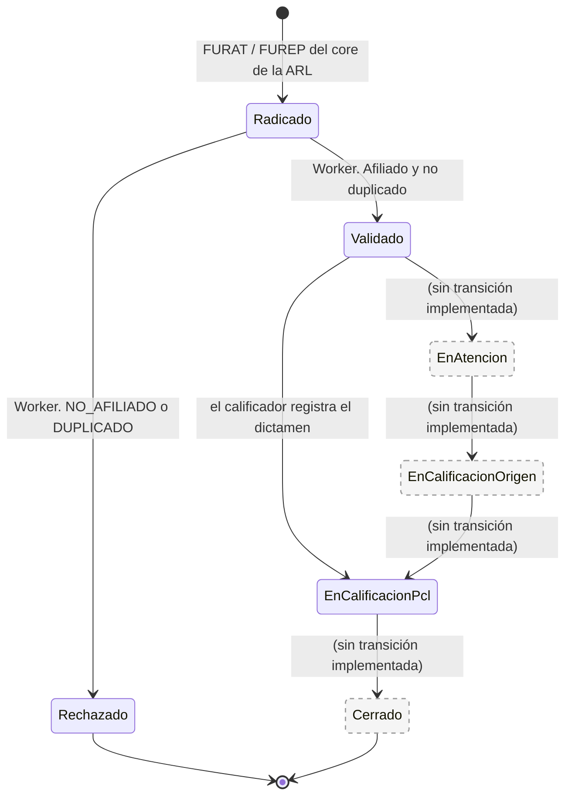
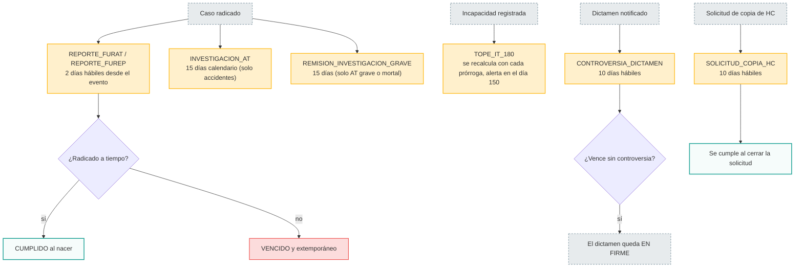
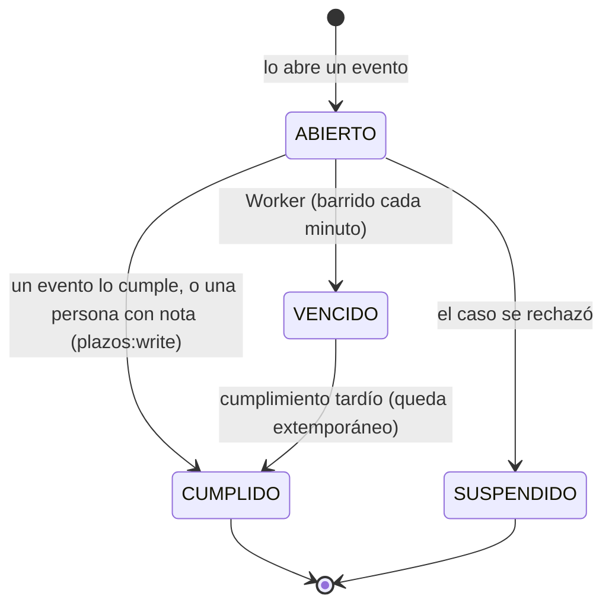

# 00 · Panorama: el ciclo de vida de un caso ATEL

Este documento cubre:

- quién interviene en un caso;
- en qué orden;
- qué hace el sistema solo.

Los detalles de cada usuario están en su propio archivo.

## 1. Mapa de actores

## 2. El caso de punta a punta

## 3. Estados del caso

Reglas que el diagrama no muestra:

- Un caso **rechazado o cerrado** no admite registros clínicos ni dictamen.
- Los códigos de activación solo se emiten desde `Validado` en adelante, nunca para un caso rechazado.
- La remisión a una IPS y la asignación de profesionales no cambian el estado del caso.
- Corregir el dictamen deja el caso en `EnCalificacionPcl` y actualiza el porcentaje.

## 4. Plazos legales (lo que corre solo)

- El Worker envía el webhook `plazo.proximo-a-vencer` al llegar `alertaEn`, y `plazo.vencido` al vencer.
- Los días hábiles usan el calendario de festivos de Colombia.
- Las cifras de los plazos están **pendientes de validación jurídica**.
