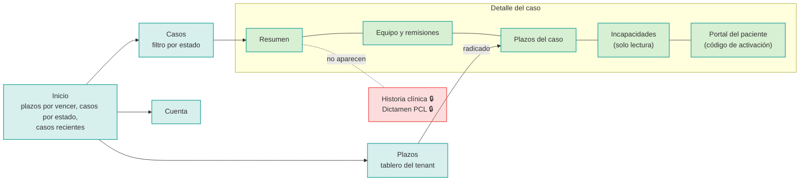
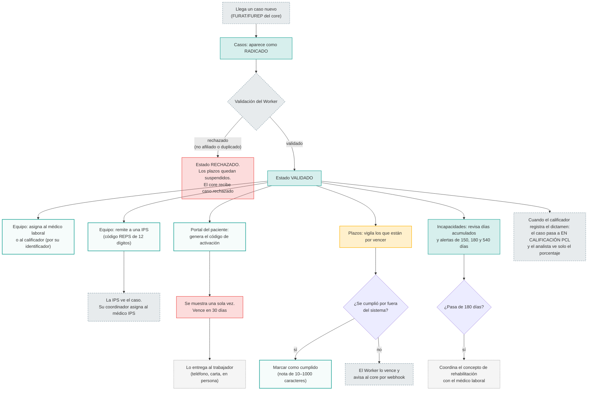
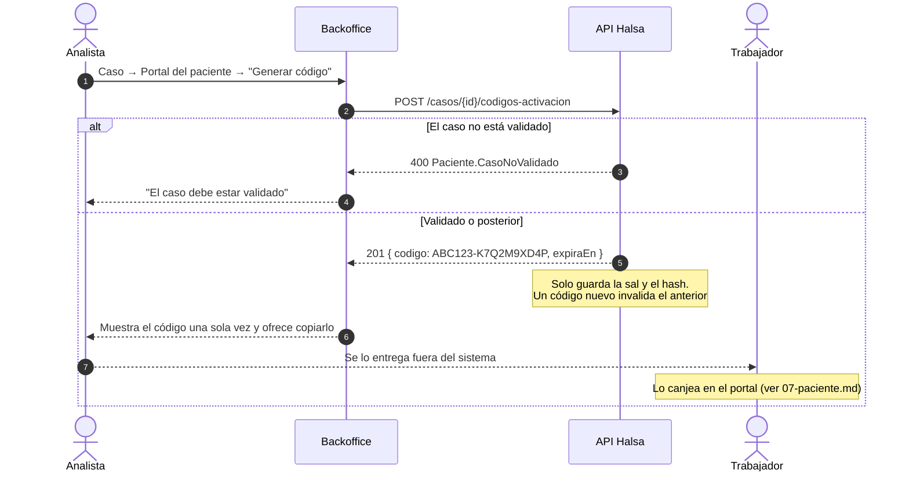

# 01 · Analista de la ARL (`analista-arl`)

**Quién es:** el gestor administrativo del caso dentro de una ARL.

**Permisos:** `casos:read`, `casos:write`, `casos:asignar`, `incapacidades:read`, `plazos:read`, `plazos:write`, `pacientes:activar`.

**Lo que nunca ve:** diagnósticos, conceptos médicos, historia clínica ni los fundamentos del dictamen. Del dictamen solo ve el **porcentaje de PCL**, que necesita para liquidar.

**Usuarios de desarrollo:** `analista.arla` (ARL_A) y `analista.arlb` (ARL_B).

## Mapa de navegación

## Flujo de trabajo principal

## El código de activación, paso a paso

## Reglas útiles

- **Asignar:**
  - La asignación es idempotente: asignar dos veces no duplica.
  - El backoffice no tiene todavía un directorio de usuarios. Se asigna por el identificador (`sub`) que cada profesional ve en su página **Cuenta**.
  - El médico laboral y el calificador **no pueden asignarse solos**: depende del analista.
- **Remitir:**
  - No se puede remitir dos veces a la misma IPS mientras la remisión esté vigente.
  - Revocar la remisión le quita a la IPS el acceso al caso.
- **Ver casos:** un analista de ARL_B nunca ve los casos de ARL_A. Si intenta abrir uno, la respuesta es "no encontrado".
