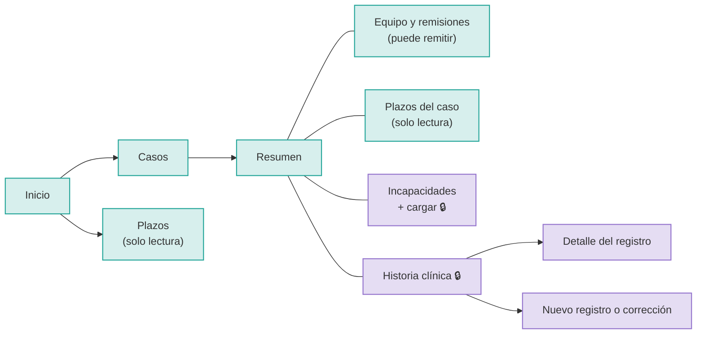
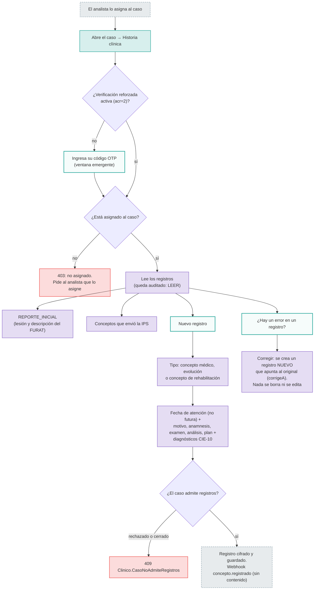
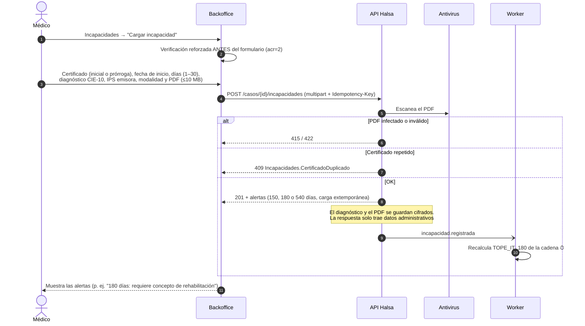

# 02 · Médico laboral de la ARL (`medico-laboral`)

**Quién es:** el médico de salud ocupacional de la ARL que lleva la historia clínica del caso.

**Permisos:** `casos:read`, `casos:write`, `incapacidades:read`, `incapacidades:write`, `plazos:read`, `clinico:read`, `clinico:write`.

**Condiciones:** todo lo clínico 🔒 exige estar **asignado al caso** (lo asigna el analista) y la **verificación reforzada** (contraseña + código OTP).

> Todavía no existe un usuario de desarrollo con este rol. El calificador (`calificador.arla`) tiene todos sus permisos y sirve para probar estos flujos.

## Mapa de navegación

## Flujo de trabajo: historia clínica

## Flujo de trabajo: cargar una incapacidad

## Reglas útiles

- **Reintentos:** si la red falla, reintentar con la misma `Idempotency-Key` no duplica la incapacidad.
- **Prórrogas:** una prórroga se encadena a la incapacidad anterior del mismo caso. Los días se acumulan por cadena.
- **Descargar el soporte PDF** también es un acceso clínico auditado: exige OTP y asignación.
