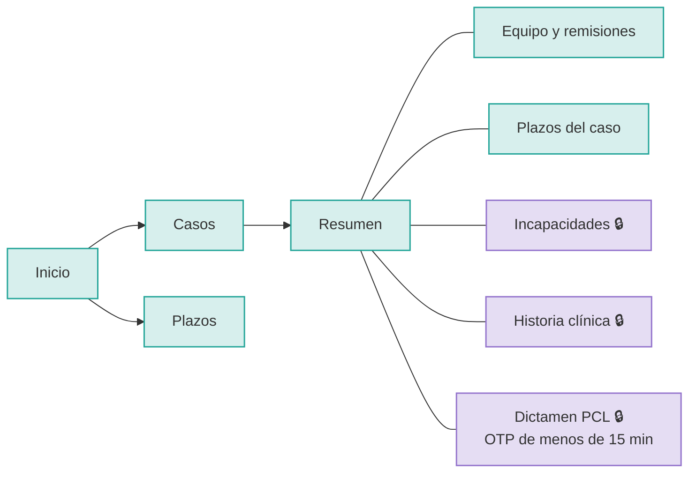
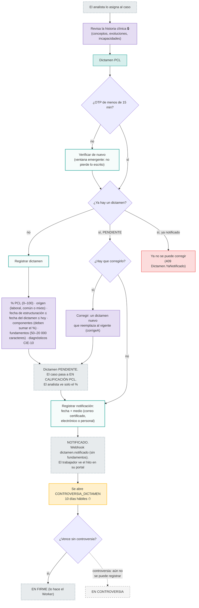
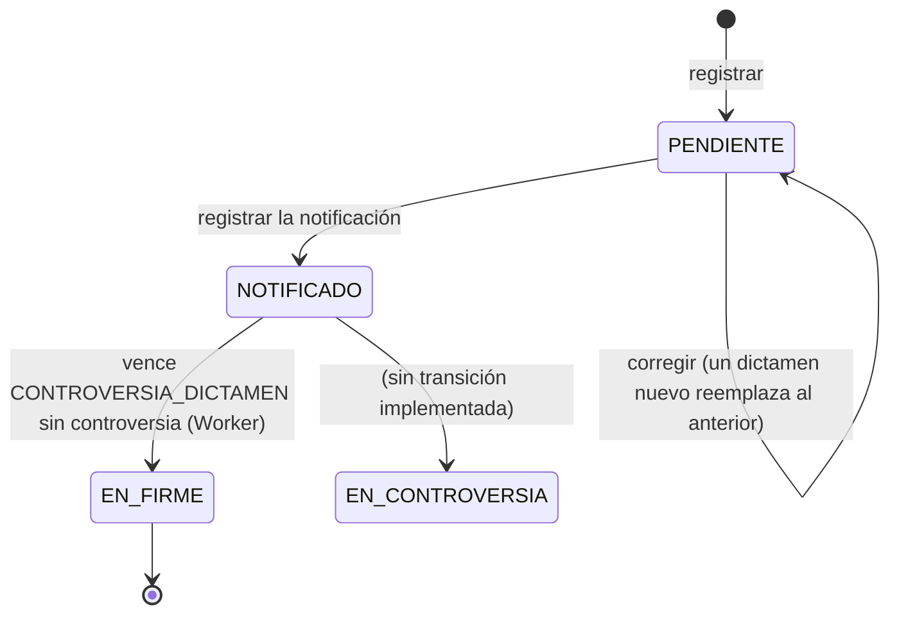
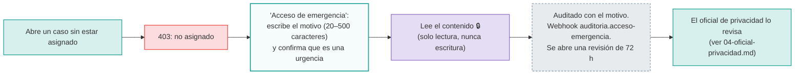

# 03 · Médico calificador de la ARL (`medico-calificador`)

**Quién es:** el médico que califica la **pérdida de capacidad laboral (PCL)** según el Decreto 1507/2014.

**Permisos:** todo lo del médico laboral ([02](02-medico-laboral-arl.md)), más `pcl:dictamen:read` y `pcl:dictamen:write`.

**Usuario de desarrollo:** `calificador.arla`. Tiene OTP configurado y además el permiso `clinico:emergencia`.

**Lo más sensible del sistema:** el dictamen exige estar asignado, la **verificación reforzada** (OTP), y además que esa verificación tenga **menos de 15 minutos**.

## Mapa de navegación

## Flujo de trabajo: del análisis al dictamen en firme

## Estados del dictamen

## Acceso de emergencia (break-the-glass)

El calificador de desarrollo tiene `clinico:emergencia`. Si necesita leer la historia o el dictamen de un caso **al que no está asignado**:

La emergencia **no salta** el tenant ni la remisión: solo salta la asignación. Registrar o notificar un dictamen siempre exige estar asignado.
