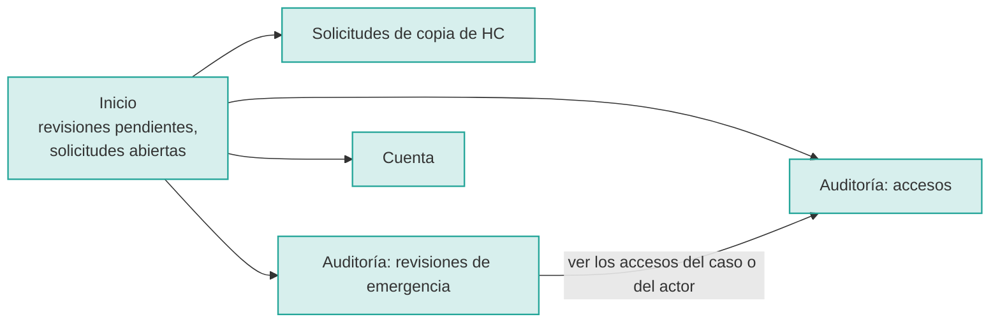
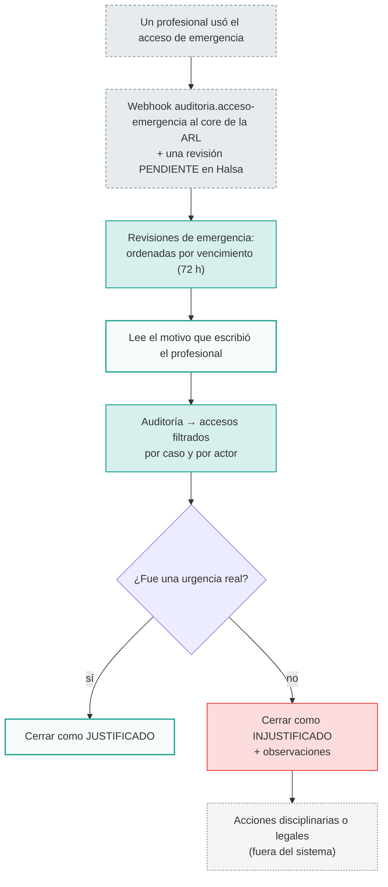
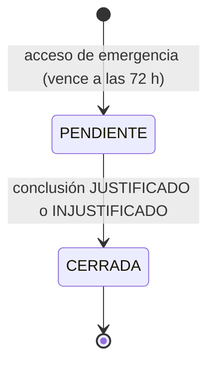
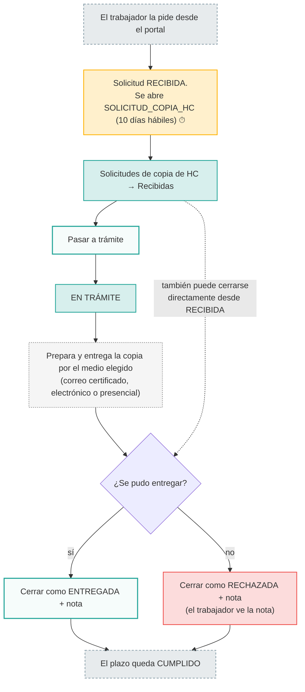
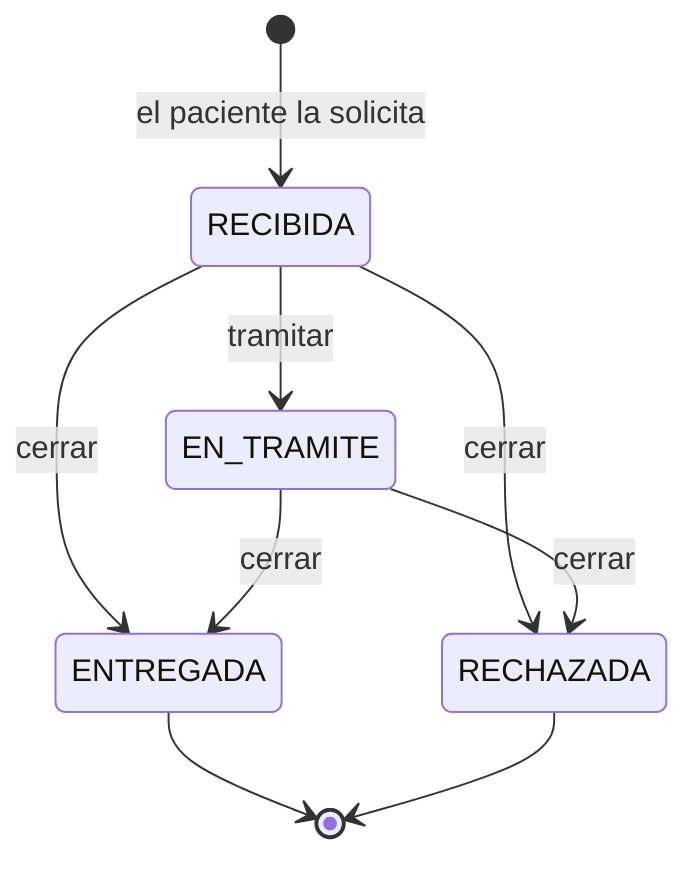
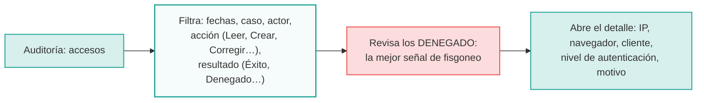

# 04 · Oficial de privacidad de la ARL (`oficial-privacidad`)

**Quién es:** el responsable de protección de datos de la ARL (Ley 1581/2012). Responde ante la SIC, la Superfinanciera y MinTrabajo.

**Permisos:** `auditoria:read`, `auditoria:export`, `auditoria:revisar`, `solicitudes-hc:gestionar`.

**Lo que no hace:** no abre casos (no tiene `casos:read`). Los radicados y los ids de caso los ve como texto, no como enlaces.

**Usuario de desarrollo:** `privacidad.arla`.

## Mapa de navegación

## Flujo A: revisar un acceso de emergencia (72 h)

## Flujo B: atender una solicitud de copia de la historia clínica

## Flujo C: investigar accesos

- El registro de auditoría es inmutable y se sella cada 5 minutos con una raíz Merkle.
- Exportarlo (`auditoria:export`) aún **no tiene endpoint**.
