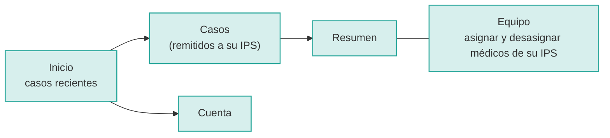
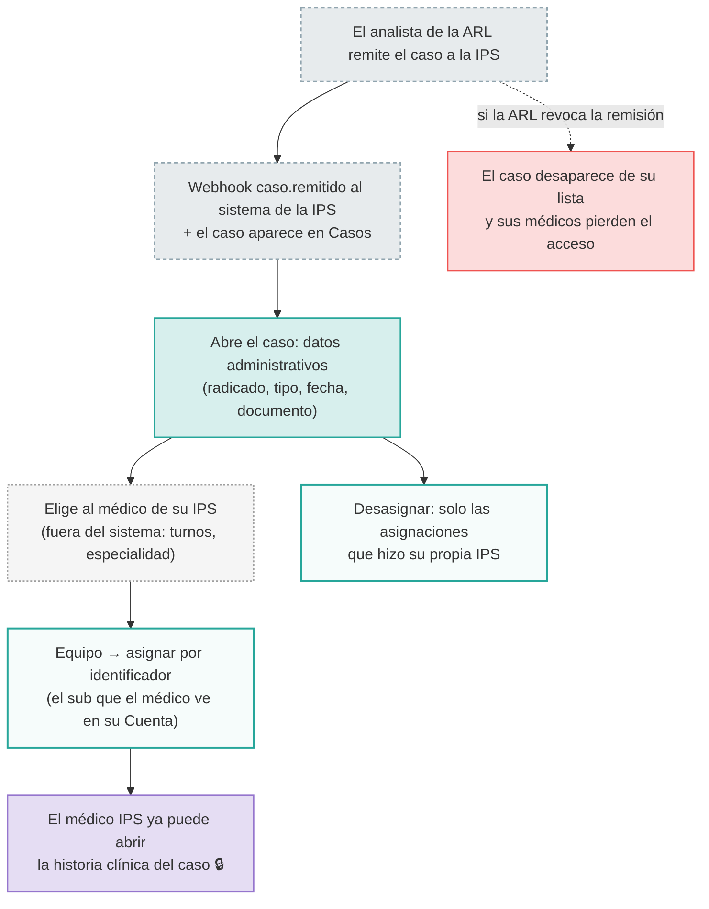

# 05 · Coordinador de la IPS (`coordinador-ips`)

**Quién es:** quien reparte, dentro de una IPS (clínica o prestador), los casos que le remiten las ARL.

**Permisos:** `casos:read` (solo los casos **remitidos a su IPS**) y `casos:asignar`.

**Contexto:** una IPS no es un tenant. Puede atender casos de varias ARL a la vez y solo ve un caso mientras su remisión esté vigente.

**Usuario de desarrollo:** `coordinador.ips` (IPS `110011234501`).

## Mapa de navegación

## Flujo de trabajo

El coordinador **no ve nada clínico**, no ve los plazos y no carga incapacidades.
