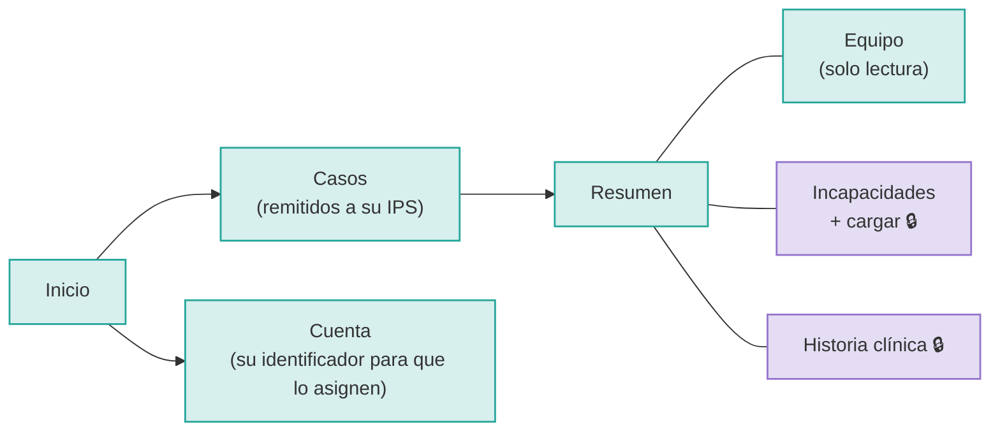
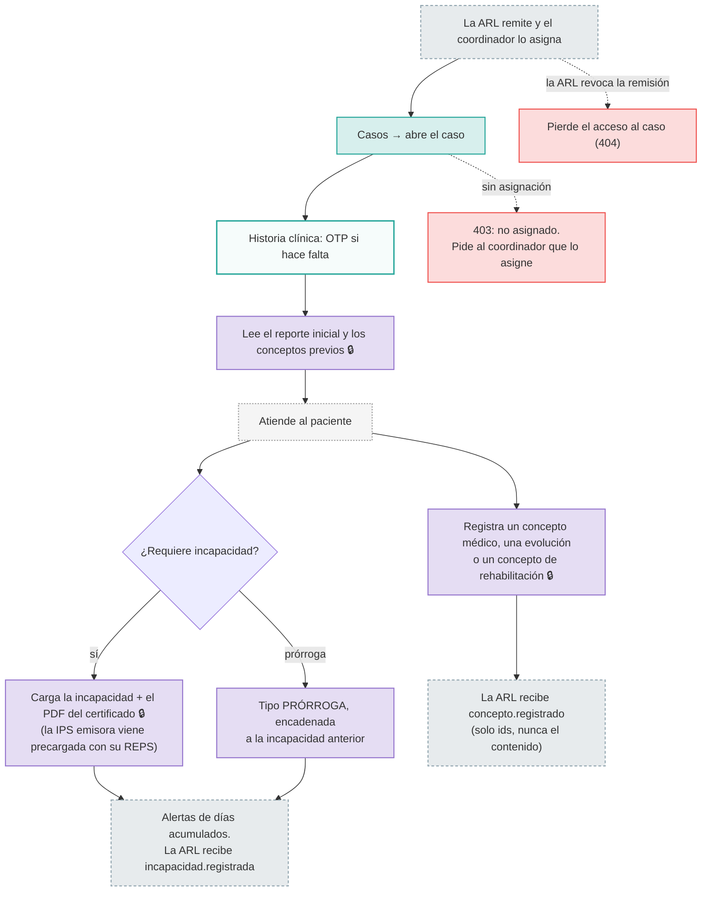

# 06 · Médico de la IPS (`medico-ips`)

**Quién es:** el médico tratante en la IPS a la que la ARL remitió el caso.

**Permisos:** `casos:read`, `clinico:read`, `clinico:write`, `incapacidades:read`, `incapacidades:write`.

**No ve:** los plazos legales ni el dictamen PCL.

**Usuario de desarrollo:** `medico.ips` (tiene OTP).

**Para tocar algo clínico 🔒 necesita tres cosas a la vez:**

1. una **remisión vigente** del caso hacia su IPS;
2. estar **asignado** por su coordinador;
3. la **verificación reforzada** (OTP).

## Mapa de navegación

## Flujo de trabajo: la atención del paciente

Lo mismo puede llegar **de máquina a máquina** desde el sistema de historia clínica de la IPS: conceptos e incapacidades por `/v1/integraciones/*`, con mTLS (ver [09-integraciones.md](09-integraciones.md)). El médico usa el backoffice cuando la IPS no tiene esa integración.
