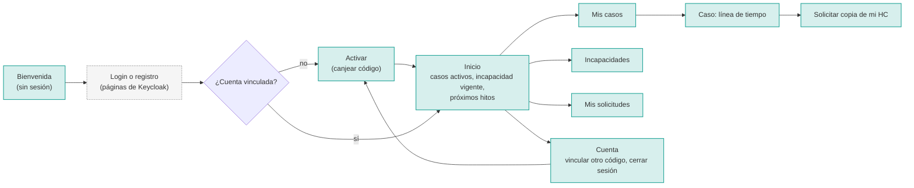
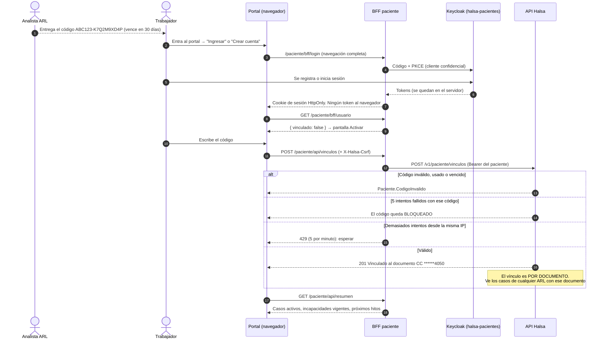
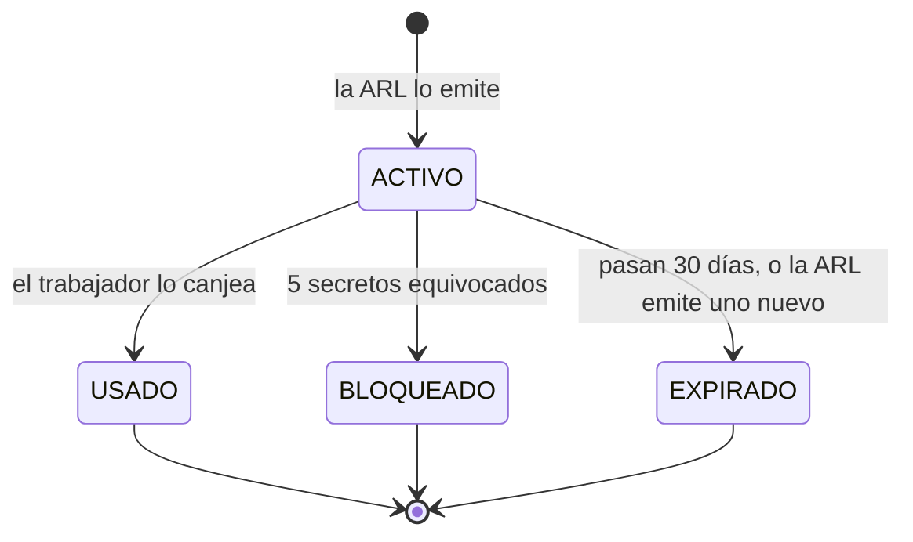
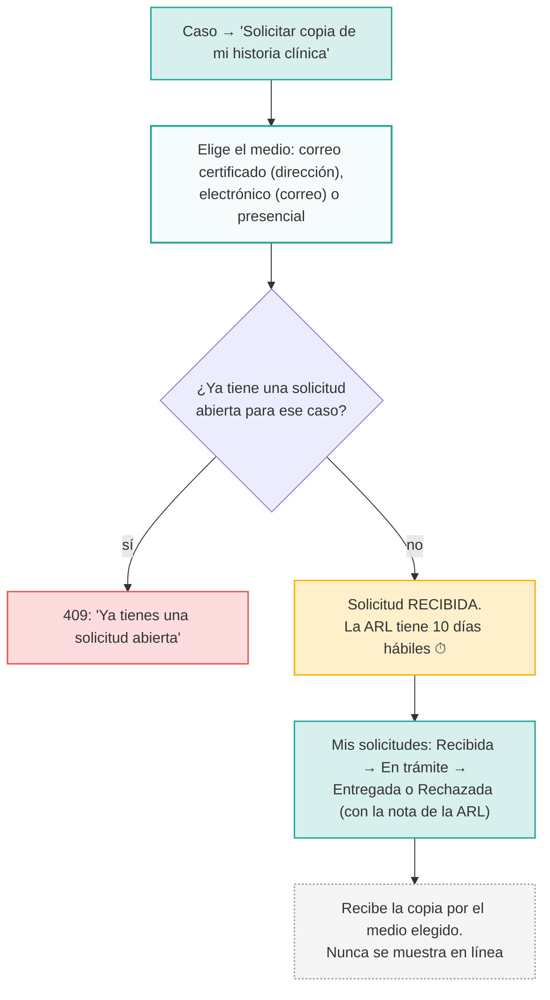
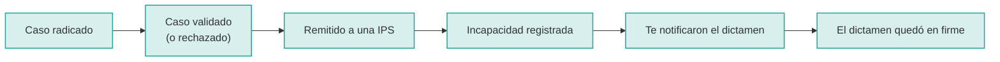

# 07 · Trabajador o paciente (portal del paciente)

**Quién es:** el trabajador accidentado o enfermo.

**Cómo entra:**

- Tiene su propia cuenta en el realm `halsa-pacientes` y la crea él mismo.
- Entra **a través del BFF**: su navegador nunca tiene un token, solo una cookie de sesión.

**Qué ve:** estados e **hitos administrativos** de sus casos, sus incapacidades y sus solicitudes. **Nunca** diagnósticos, porcentajes ni fundamentos.

**Usuario de desarrollo:** `paciente.dev` / `dev`.

## Mapa de navegación

## Flujo: de "recibí un código" a "veo mi caso"

## Estados del código de activación

## Flujo: solicitar la copia de la historia clínica

## Lo que aparece en su línea de tiempo

Los "próximos hitos" del inicio son dos: **fin de la incapacidad** y **último día para controvertir el dictamen**.
