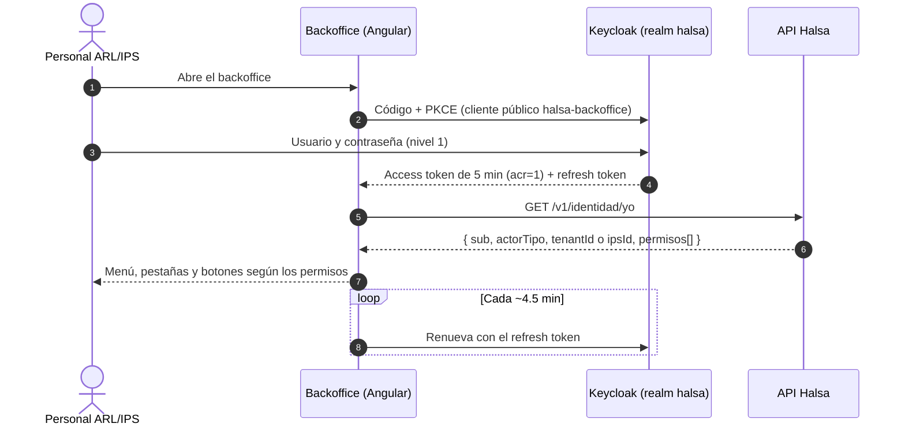
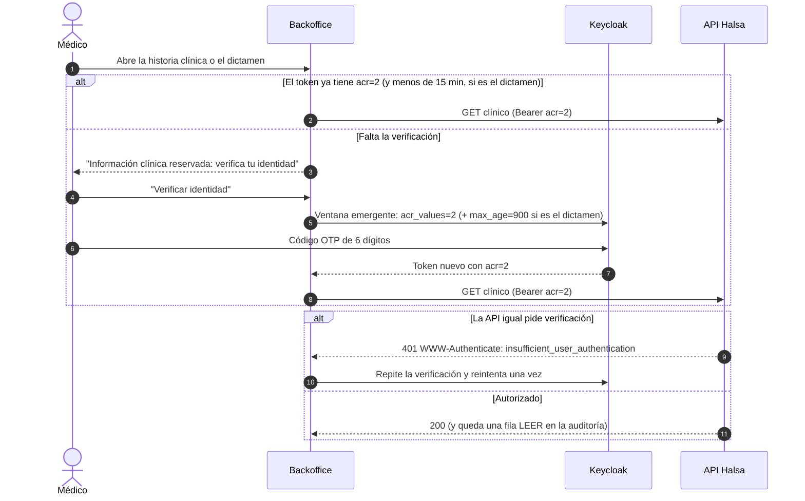
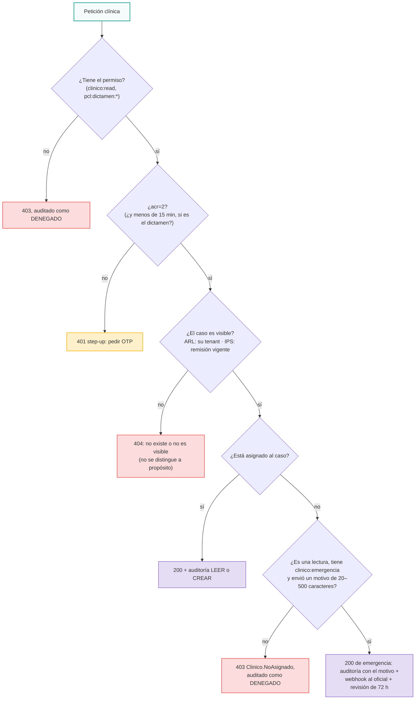
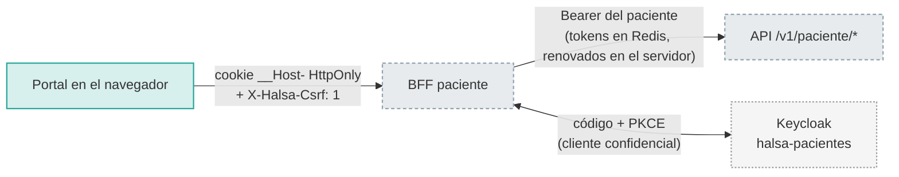

# 08 · Autenticación y accesos sensibles (todos los usuarios)

## 1. Entrada del personal (ARL e IPS) al backoffice

## 2. Verificación reforzada (step-up a OTP)

| Acción | Nivel exigido |
| --- | --- |
| Leer o escribir la historia clínica, descargar el soporte de una incapacidad | `acr=2` |
| Cargar una incapacidad | `acr=2` |
| Leer, registrar o notificar el dictamen PCL | `acr=2` **y** la verificación tiene menos de 15 minutos |

## 3. ¿Puedo ver este contenido clínico? (el árbol de decisión de la API)

Además, la base de datos repite estos controles **por su cuenta**:

- seguridad por filas (RLS) por tenant y por remisión;
- un rol sin acceso al esquema clínico para lo administrativo;
- cifrado de campo.

Si el frontend o la API fallan, la base sigue cerrada.

## 4. Entrada del paciente (BFF, sin tokens en el navegador)

- Las rutas del paciente **nunca reciben un id de trabajador**: todo se resuelve desde su cuenta y su vínculo, así que no puede pedir los datos de otro.
- Un token del personal no sirve en las rutas del paciente, ni al revés, porque los emisores son distintos.
