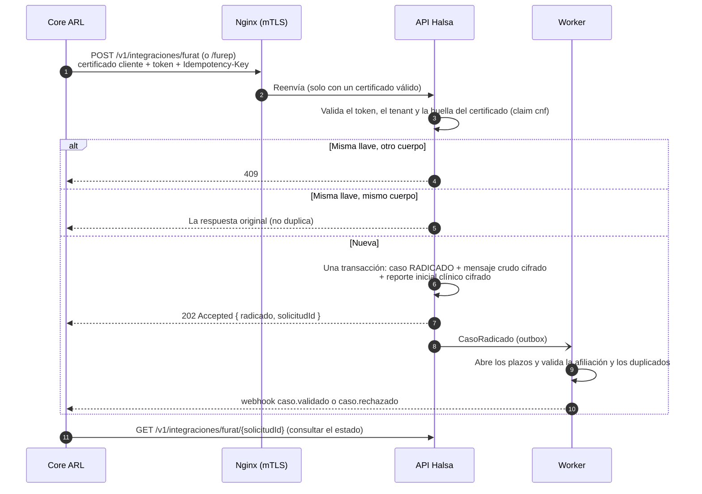
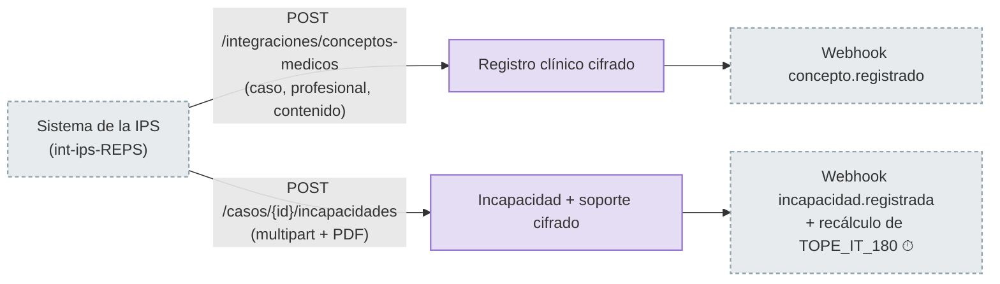
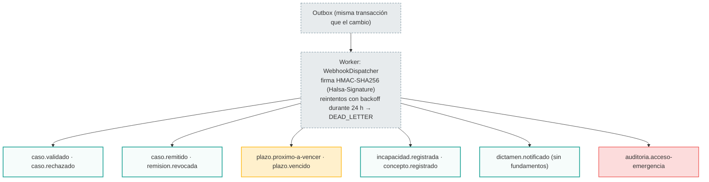

# 09 · Integraciones (sistemas de la ARL y de la IPS)

Estos actores **no son personas**. Son service accounts de Keycloak (`int-arl-{codigo}`, `int-ips-{reps}`):

- autenticadas con `private_key_jwt`;
- con tokens **amarrados al certificado del cliente** (mTLS, RFC 8705);
- y con una `Idempotency-Key` obligatoria en cada escritura.

No tienen pantallas: aquí se documentan porque **inician** o **alimentan** los flujos de las personas.

## 1. El core de la ARL radica un caso

## 2. El sistema de la IPS envía información clínica

La IPS solo puede escribir en casos **remitidos** a ella.

## 3. Webhooks que salen hacia los sistemas suscritos

- **Entrega:** al menos una vez. El receptor deduplica por `eventoId`.
- **Gestión:** las suscripciones (`/v1/integraciones/suscripciones-webhook`) las gestionan los propios sistemas (`webhooks:manage`). Ninguna persona tiene ese permiso, así que no hay pantalla para ellas.
