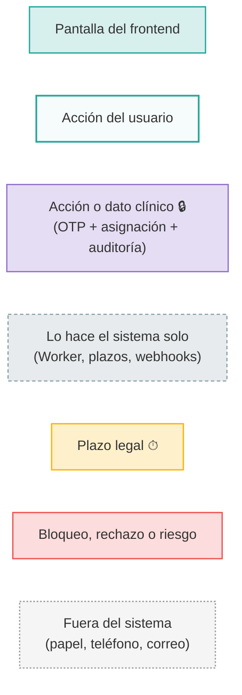

# Flujos de trabajo por usuario

Diagramas de **qué hace cada usuario de Halsa**:

- qué pantallas usa;
- en qué orden trabaja;
- con quién se cruza su trabajo;
- qué hace el sistema por su cuenta (Worker, plazos, webhooks).

Están escritos en [Mermaid](https://mermaid.js.org/). GitHub y el preview de Markdown de VS Code o Rider los dibujan directamente. Para editarlos también sirve <https://mermaid.live>.

> **Fuente de verdad:** el código del backend al 2026-10-17 (SPEC 01–14) y la navegación del frontend definida en `../../../../Halsa.Frontend/prompt/02_handoff-frontend.md`. Si un diagrama y el código no coinciden, manda el código: corrige el diagrama.

## Índice

| Archivo | Usuario | Rol de Keycloak | En una frase |
| --- | --- | --- | --- |
| [00-panorama.md](00-panorama.md) | Todos | — | El ciclo de vida completo de un caso y quién interviene en cada paso. |
| [01-analista-arl.md](01-analista-arl.md) | Analista de la ARL | `analista-arl` | Gestiona el expediente administrativo: asigna, remite, vigila plazos y emite códigos de activación. Nunca ve lo clínico. |
| [02-medico-laboral-arl.md](02-medico-laboral-arl.md) | Médico laboral de la ARL | `medico-laboral` | Lleva la historia clínica del caso y carga incapacidades. |
| [03-medico-calificador.md](03-medico-calificador.md) | Médico calificador de la ARL | `medico-calificador` | Califica la pérdida de capacidad laboral (PCL), registra el dictamen y su notificación. |
| [04-oficial-privacidad.md](04-oficial-privacidad.md) | Oficial de privacidad de la ARL | `oficial-privacidad` | Audita los accesos, revisa los accesos de emergencia y atiende las solicitudes de copia de la HC. |
| [05-coordinador-ips.md](05-coordinador-ips.md) | Coordinador de la IPS | `coordinador-ips` | Recibe los casos remitidos a su IPS y les asigna médicos. |
| [06-medico-ips.md](06-medico-ips.md) | Médico de la IPS | `medico-ips` | Atiende los casos remitidos y asignados: conceptos clínicos e incapacidades. |
| [07-paciente.md](07-paciente.md) | Trabajador (paciente) | realm `halsa-pacientes` | Vincula su cuenta con un código y consulta sus casos, incapacidades y solicitudes. |
| [08-autenticacion-y-accesos-sensibles.md](08-autenticacion-y-accesos-sensibles.md) | Todos | — | Login, verificación reforzada (OTP), reglas de acceso clínico y acceso de emergencia. |
| [09-integraciones.md](09-integraciones.md) | Sistemas de la ARL y de la IPS | `integracion-arl`, `integracion-ips` | Lo que llega de máquina a máquina (FURAT/FUREP, conceptos, incapacidades) y los webhooks que salen. |

## Leyenda (colores de los flujogramas)

## Matriz rápida: quién puede qué

| | Analista | Méd. laboral | Calificador | Privacidad | Coord. IPS | Médico IPS | Paciente |
| --- | :-: | :-: | :-: | :-: | :-: | :-: | :-: |
| Ver casos | ✓ (su ARL) | ✓ (su ARL) | ✓ (su ARL) | — | ✓ (remitidos) | ✓ (remitidos) | ✓ (los suyos) |
| Asignar profesionales | ✓ | — | — | — | ✓ (de su IPS) | — | — |
| Remitir a una IPS | ✓ | ✓ | ✓ | — | — | — | — |
| Plazos legales | ✓ + cumplir | ver | ver | — | — | — | — |
| Historia clínica 🔒 | — | ✓ | ✓ | — | — | ✓ | — |
| Cargar incapacidad 🔒 | — | ✓ | ✓ | — | — | ✓ | — |
| Dictamen PCL 🔒 | ve solo el % | — | ✓ | — | — | — | ve solo hitos |
| Código de activación | emite | — | — | — | — | — | canjea |
| Copia de la HC | — | — | — | tramita | — | — | solicita |
| Auditoría | — | — | — | ✓ | — | — | — |

## Estados que existen pero que aún no tienen transición

El código define estos estados, pero **ninguna operación lleva a ellos todavía**. Los diagramas los muestran punteados para no prometer un flujo que no existe:

- Caso: `EnAtencion`, `EnCalificacionOrigen` y `Cerrado`.
- Dictamen: `EN_CONTROVERSIA` (no hay endpoint para registrar una controversia).
